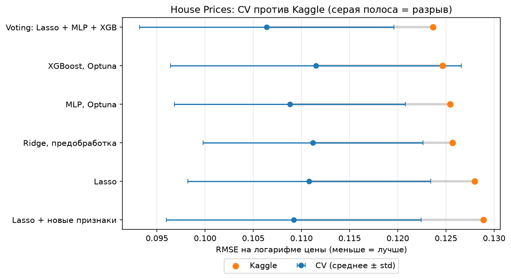
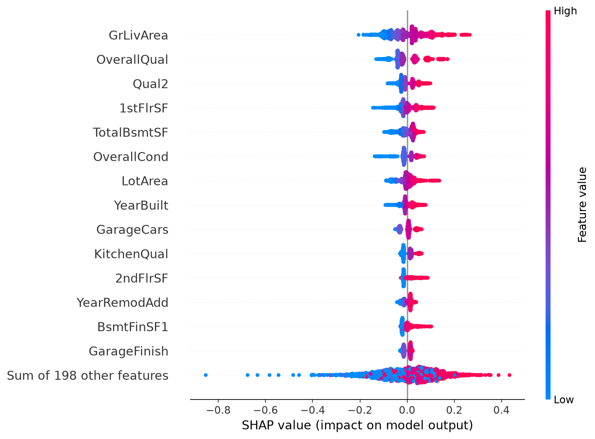
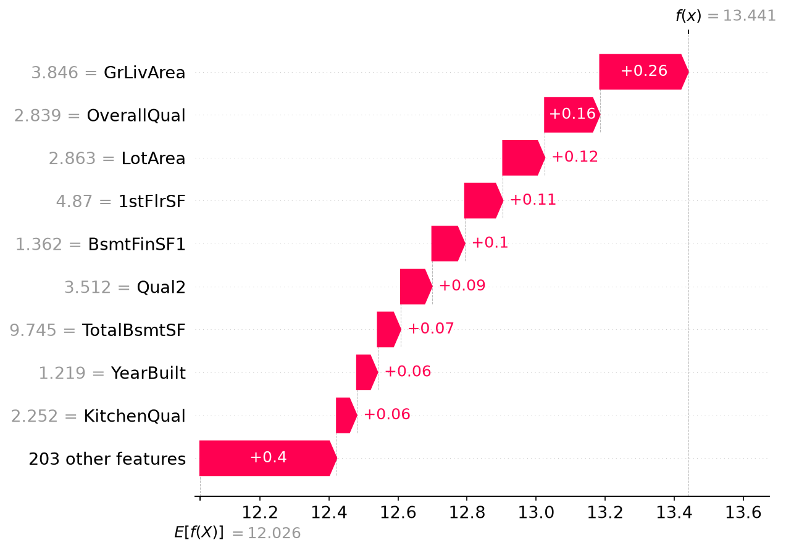
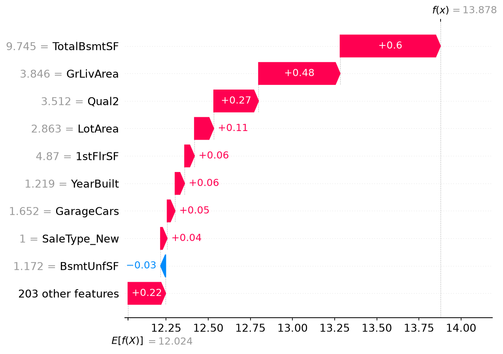

# House Prices: предсказание цены дома

Задача Kaggle House Prices, регрессия. Метрика: RMSE на логарифме цены. В train 1460 домов (2 выброса удалены), в test 1459, 79 исходных признаков.

## Как запустить

1. Скачайте `train.csv` и `test.csv` со страницы соревнования
   https://www.kaggle.com/competitions/house-prices-advanced-regression-techniques/data и положите в папку `data/`.
2. Установите зависимости:
   ```
   python -m venv .venv
   .venv\Scripts\activate        # Linux/macOS: source .venv/bin/activate
   pip install -r requirements.txt
   ```
3. Запустите:
   ```
   python main.py                                                          # лучшая модель из config.yaml
   python main.py model.name=lasso model.params.alpha=0.00041 model.params.max_iter=20000   # любой параметр из командной строки
   ```
   Выводит CV RMSE и сохраняет сабмит в `outputs/submission_voting.csv`.

## Структура

| Файл | Что внутри |
|---|---|
| `config.yaml` | Все настройки: пути, признаки, предобработка, модель, пространства поиска Optuna и подобранные параметры |
| `main.py` | Одной командой воспроизводит лучшую модель из конфига и сохраняет сабмит. Параметры можно менять из командной строки |
| `src/data.py` | Загрузка данных, заполнение пропусков, порядковые шкалы, препроцессинг, сохранение сабмитов |
| `src/features.py` | Feature Engineering: суммарные площади, возраст дома, флаги, квадрат качества |
| `src/models.py` | Список моделей, сборка пайплайна и Voting-ансамбля из конфига |
| `src/nn.py` | Нейросеть-регрессор на PyTorch в обёртке sklearn, с прогресс-баром |
| `src/tuning.py` | Подбор параметров через Optuna по пространству из конфига |
| `src/validation.py` | Кросс-валидация, журнал результатов |
| `eda.ipynb` | Разведочный анализ данных |
| `experiments.ipynb` | Все эксперименты по шагам |
| `reports/` | Итоговая таблица, график CV против Kaggle и графики SHAP |
| `docs/project_log.md` | Подробный журнал проекта: что делали на каждом шаге, эксперименты, решения, что не сработало |

## Как устроено решение

- **Цель** логарифмируется (`log1p`), в сабмите возвращается обратно (`expm1`). Так RMSE на логарифме совпадает с метрикой Kaggle.
- **Валидация**: StratifiedKFold на 5 фолдов, стратификация по 10 корзинам цены. Предсказание на test усредняется по 5 моделям фолдов.
- **Предобработка до пайплайна** (не зависит от данных, утечки нет): пропуски «объекта нет» → `"None"` / 0, порядковые категории (качество, отделка и т.д.) → числа по шкалам из конфига, новые признаки.
- **Предобработка в пайплайне** (обучается на train каждого фолда): медиана для пропусков, `log1p` для скошенных площадей, StandardScaler, OneHot для категорий.
- **Выбросы**: из train удалены два огромных дома с низкой ценой (Id 524, 1299).

## Результаты

Лучшая модель: VotingRegressor из Lasso, MLP и XGBoost (параметры подобраны Optuna, равные веса). CV 0.1064 ± 0.0132, Kaggle **0.12364**.

| Модель | CV | Kaggle |
|---|---|---|
| Voting: Lasso + MLP + XGBoost | 0.1064 ± 0.0132 | **0.12364** |
| XGBoost (Optuna) | 0.1115 ± 0.0151 | 0.12464 |
| MLP (Optuna) | 0.1088 ± 0.0120 | 0.12544 |
| Ridge (после предобработки) | 0.1112 ± 0.0114 | 0.12569 |
| Lasso | 0.1108 ± 0.0126 | 0.12797 |
| Lasso + новые признаки | 0.1092 ± 0.0132 | 0.12887 |
| Baseline: LinReg на 4 признаках | 0.1842 ± 0.0296 | 0.18030 |

Полная таблица: `reports/summary.csv`. Подробная история всех экспериментов и решений: [docs/project_log.md](docs/project_log.md).



## Выводы

1. Больше всего дала предобработка. Ridge на всех признаках без обработки давал CV 0.1445, после заполнения пропусков, порядковых шкал, логарифма площадей и удаления двух выбросов 0.1112. Подбор моделей и параметров после этого улучшил CV ещё на 0.005.

2. Линейные модели здесь сильнее деревьев. Lasso (0.1108) лучше настроенных бустингов (0.111–0.114), случайный лес и KNN заметно хуже (0.132 и 0.162). Цена почти линейно зависит от площади и качества, если их правильно преобразовать.

3. Kaggle хуже CV на 0.013–0.020 у всех моделей. Выбросы удалены из train, а в test есть похожий дом (Id 2550, огромная площадь и максимальное качество). Линейные модели продолжают прямую и оценивают его примерно в миллион, деревья нет. Поэтому XGBoost лучший из одиночных моделей на Kaggle, хотя по CV уступает Lasso и MLP.

4. Ансамбль помог. Линейные модели и бустинг ошибаются в разных местах (корреляция предсказаний 0.989 против 0.996 внутри групп), и простое среднее Lasso, MLP и XGBoost лучшее и по CV, и по Kaggle. Stacking с подбором весов не обогнал среднее: модели почти равны по качеству, и подобранные веса только подгоняются под фолды.

5. Новые признаки почти не помогли. Суммы и разности площадей линейная модель строит сама. Помог только квадрат общего качества (нелинейный признак): CV Lasso 0.1106 → 0.1092. На Kaggle результат при этом хуже, потому что квадрат усилил переоценку дома-выброса.

## Интерпретация модели (SHAP)

SHAP раскладывает прогноз каждого дома на вклады признаков. Для XGBoost главные признаки это жилая площадь, общее качество и площади этажей и подвала; почти у всех признаков высокие значения поднимают цену, низкие опускают.

Разбор дома-выброса из test (Id 2550) объясняет разрыв CV и Kaggle. Его подвал и первый этаж в полтора раза больше любого дома в train. Lasso продолжает линейную зависимость за пределы данных: один подвал добавляет к логарифму цены +0.60, итоговый прогноз 1.06 млн при максимальной цене в train 755 тыс. У XGBoost вклад подвала +0.07, потому что дерево не выходит за пороги, выученные на train, и прогноз 688 тыс.



| XGBoost, дом 2550 | Lasso, дом 2550 |
|---|---|
|  |  |
